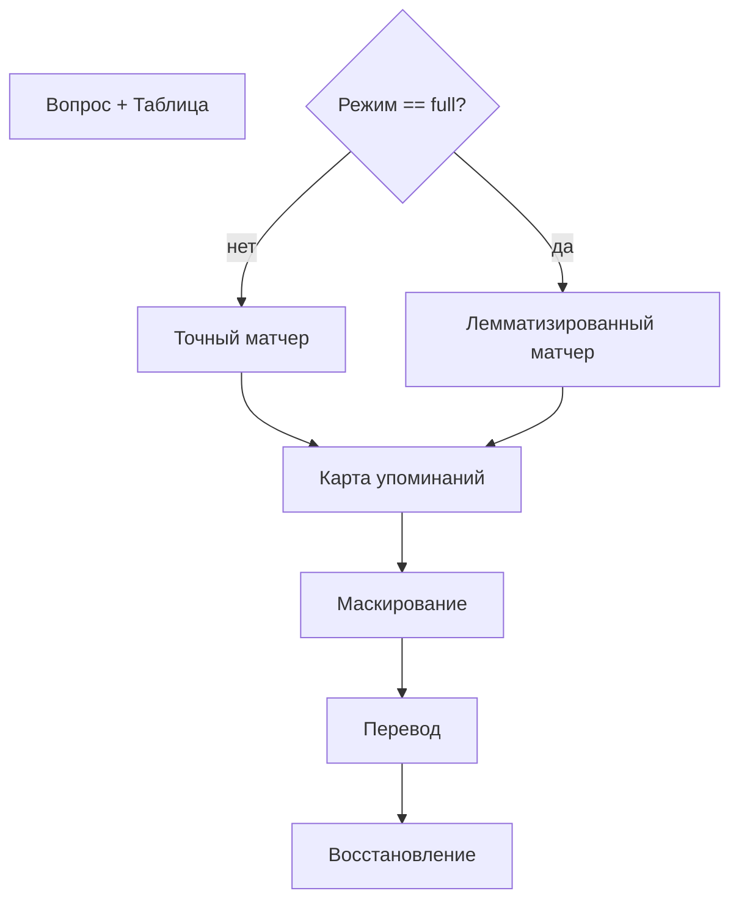
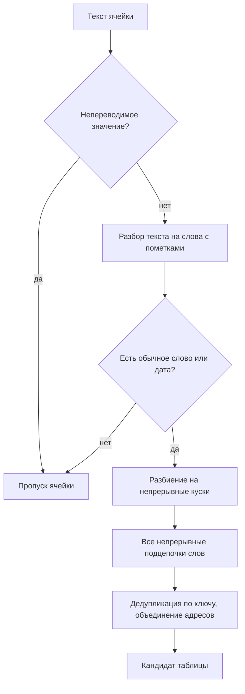

# Алгоритм поиска табличных упоминаний

Документ описывает, как проект находит «упоминания таблицы» (mention) во вопросе — фрагменты вопроса, которые ссылаются на конкретные ячейки или заголовки таблицы. Их находят, маскируют, переводят, а потом восстанавливают обратно, чтобы языковая модель не переводила имена сущностей и числа.

---

## 1. Общий контекст

Проект — перевод вопросов WikiTableQuestions. Перед переводом вопроса необходимо понять, какие его части ссылаются на таблицу.

Используются **два алгоритма**, выбор зависит от режима (`translation.mode`):

| Режим | Алгоритм |
|-------|----------|
| `shell_only` / `mentions_only` | Точный матчер по нормализованным строкам |
| `full` | Лемматизированный матчер по базовым формам слов |

Оба возвращают результат поиска (список упоминаний + список неоднозначных), который превращается в карту упоминаний, а затем применяется через маскирование и восстановление.

---

## 2. Точный матчер (нормализованный)

Строго детерминированный, без нейромоделей. Работает через приведение строк к сопоставимому виду и построчный поиск подстрок.

### Шаг 1. Нормализация
- Для кандидатов таблицы: применяется нормализация Юникода → приведение регистра к нижнему → схлопывание пробелов → обрезка и удаление внешней пунктуации.
- Для вопроса: то же самое, но **с сохранением карты обратной привязки** — каждый символ нормализованного текста помнит, какому символу исходного вопроса он соответствует. Это критично для корректной маскировки (нужно знать, где именно в исходном вопросе находился найденный фрагмент).

### Шаг 2. Построение кандидатов
- Для каждого заголовка и каждой ячейки вычисляется нормализованная форма.
- Отбрасываются пустые значения и (если запрещены) числовые.
- Кандидат = нормализованный текст + исходный текст + тип источника (заголовок/ячейка) + адрес (строка/колонка).

### Шаг 3. Сбор совпадений
- В нормализованном вопросе ищутся все вхождения каждого нормализованного кандидата.
- **Защита от вложенных ложных совпадений**: если по краям совпадения стоит буква или цифра (то есть совпадение — часть более длинного слова, например заголовок «А» внутри слова «Акт»), такое совпадение отбрасывается.
- Позиция из нормализованного пространства переводится обратно в исходный текст через карту отображения.

### Шаг 4. Выбор максимальных непересекающихся совпадений
- Совпадения группируются по (начало, конец, нормализованный текст).
- Сортировка по убыванию длины → жадный выбор непересекающихся. **Длинное совпадение блокирует вложенные короче** (правило максимального фрагмента), чтобы, например, при «Нью Йорк Сити» не замаскировать только «Йорк».

### Шаг 5. Разрешение неоднозначности
- Один адрес → совпадение однозначно.
- Несколько повторов одной нормализованной ячейки **внутри одной колонки** → однозначно (все строки сохраняются, позже требуется, чтобы их переведённые значения были идентичны).
- Иначе → попадает в список неоднозначных, и адрес автоматически не выбирается. Поведение задаётся настройкой (`needs_review` — пометить на проверку, или `failed` — завершить ошибкой).

Однозначные группы становятся упоминаниями с маской вида `<TABLE_REF_0000>`, текстом, адресом и исходным текстом ячейки.

---

## 3. Лемматизированный матчер (full)

Сопоставляет вопрос и таблицу по **базовым формам слов**, допуская разные словоформы (например, «живёт» ↔ «жить»). Состоит из двух частей: построение кандидатов таблицы и сопоставление с вопросом.

### 3.1. Определение табличных кандидатов (подробно)

Смысл: превратить содержимое таблицы в набор «эталонных фрагментов», с которыми потом сверяются фрагменты вопроса. Кандидат — осмысленная подстрока ячейки (или заголовка) вместе с адресом её местоположения в таблице.

**Шаг 1. Перебор всех ячеек.** Берутся подряд: все заголовки (адрес «только колонка, без строки») и все ячейки данных (адрес «строка + колонка»). Каждая позиция — точка появления кандидатов.

**Шаг 2. Отсев «служебных» значений.** Перед обработкой проверяется, не является ли значение непереводимым мусором: пустая строка, чистое число, интернет-адрес, идентификатор. Если да — ячейка полностью пропускается. Такие значения не сопоставляются с вопросом, не переводятся и не должны засорять набор эталонов.

**Шаг 3. Разбор текста на слова с пометками.** Каждое оставшееся значение прогоняется через языковую модель, которая:
- режет текст на отдельные слова;
- для каждого слова определяет: базовую (словарную) форму, часть речи, является ли оно числом, является ли оно датой по смыслу, а не по виду, позицию в исходном тексте.

Дополнительно: если слово содержит дефисы, склеенные плотно без пробелов (`а-б-в`), вся цепочка считается **одним** словом. А `а - б` с пробелами — разные слова.

**Шаг 4. Проверка «есть ли что сопоставлять».** Если в ячейке нет ни одного «обычного слова» (не пунктуация, не число, не дата), и нет даты (когда даты разрешены) — ячейка дальше не обрабатывается. Из ячейки, состоящей только из чисел и знаков препинания, кандидаты не делают.

**Шаг 5. Разбиение на непрерывные куски.** Текст ячейки делится на **максимальные непрерывные последовательности значимых слов**, разделённые пунктуацией. Каждый кусок — «непрерывный блок». Пример: `"Нью Йорк, 1990"` → два блока: `[Нью, Йорк]` и `[1990]`. Пунктуация — граница между блоками. Каждый блок запоминается отдельно для последующего перевода содержимого колонки.

**Шаг 6. Порождение всех непрерывных подстрок каждого блока.** Для каждого блока строятся все возможные непрерывные подпоследовательности его слов — от одиночного слова до всего блока целиком. Для блока `[Нью, Йорк]`: `[Нью]`, `[Йорк]`, `[Нью, Йорк]`.

Для каждой подпоследовательности считается:
- **ключ сопоставления** — вычислительное «имя», по которому сверяют с вопросом. Строится из базовых форм слов: обычные слова → базовые формы без не-буквенно-цифровых символов в нижнем регистре; числа → как написаны; даты → как написаны, в нижнем регистре;
- **исходный текст** — точная подстрока, вырезанная из ячейки (по началу первого и концу последнего слова);
- **длина** — сколько слов входит;
- **аннотации** — для каждого слова по порядку: его форма, часть речи, тип сущности.

**Шаг 7. Объединение одинаковых кандидатов (дедупликация).** Все черновики со всех ячеек складываются вместе. Если у нескольких подстрок один и тот же ключ сопоставления (одинаковые базовые формы), они не создают отдельных кандидатов, а объединяются в один: у первого появления сохраняются исходный текст и аннотации, к списку адресов кандидата **добавляются адреса** всех ячеек, где встретилась эта же подстрока. Пример: слово «Нью» и в заголовке, и в ячейке → один кандидат, указывающий на обе позиции. Каждому уникальному кандидату выдаётся стабильный идентификатор, вычисленный из ключа, исходного текста и целевого языка (детерминированно: одинаковый набор всегда даёт одинаковый идентификатор).

**Шаг 8. Сохранение и кэширование.** Итог по таблице: список кандидатов в порядке первого появления (с ключом, исходным текстом, длиной, аннотациями и всеми адресами) + список непрерывных блоков по каждому адресу (для перевода колонок). Готовый набор **кэшируется** по хешу от содержимого таблицы и целевого языка — повторная обработка той же таблицы не переразбирает ячейки.

### 3.2. Сопоставление с вопросом

**Шаг 1. Кандидаты вопроса.** Вопрос разбирается на слова, режется на непрерывные блоки (без пунктуации), из каждого блока порождаются все непрерывные подцепочки. Каждой подцепочке — ключ сопоставления, как у таблицы. Из **одиночных** слов отбрасываются стоп-слова (артикли, предлоги, частицы), а также числа и даты — по настройкам.

**Шаг 2. Поиск совпадений.** Строится словарь ключей табличных кандидатов. Матчатся те кандидаты вопроса, чей ключ есть в таблице.

**Шаг 3. Выбор максимальных непересекающихся.** Сортировка по убыванию длины → жадный выбор непересекающихся; длинное совпадение блокирует пересекающиеся.

**Шаг 4. Формирование упоминаний.** Каждое совпадение → упоминание с маской, текстом вопроса, ключом, адресом, исходным текстом ячейки, типом (заголовок/ячейка) и идентификатором кандидата. Неоднозначных упоминаний здесь **не бывает** — этот матчер их не порождает.

---

## 4. Маскирование и восстановление

- **Маскирование** — замена найденных фрагментов на `<TABLE_REF_XXXX>` (в обратном порядке по позициям, чтобы не сбить индексы).
- **Маскирование с тегами** — оборачивание фрагмента в открывающий/закрывающий теги (для full-режима, чтобы модель видела исходный текст).
- **Восстановление исходного текста** — возврат **точного исходного фрагмента вопроса**, а не ячейки таблицы.
- **Восстановление из таблицы** — подстановка переведённых значений из таблицы по маске; при множественных эквивалентных адресах требует идентичности переведённых значений (защита от рассинхронизации).

---

## 5. Резюме

Алгоритм определения табличных кандидатов (full) сводится к: **разобрать каждый заголовок и каждую ячейку на слова → отбросить непереводимые значения → нарезать на непрерывные куски → породить все непрерывные подцепочки слов → каждой присвоить нормализованный «ключ сопоставления» → склеить одинаковые по ключу в один кандидат, запомнив все адреса → закэшировать.** Эти кандидаты потом сравниваются с аналогично построенными фрагментами вопроса, и совпавшие по ключу превращаются в упоминания таблицы.

Логика поиска упоминаний — **детерминированная** в точном матчере (без нейромоделей) и контролируется настройками: какие части речи исключать, разрешать ли числа и даты, включать ли заголовки, как вести себя при неоднозначности.
